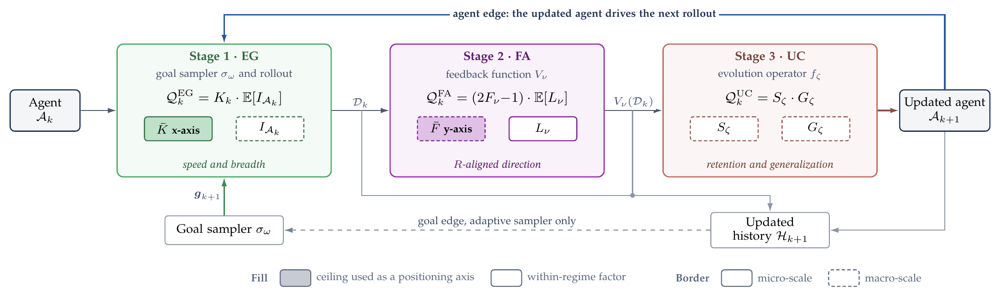
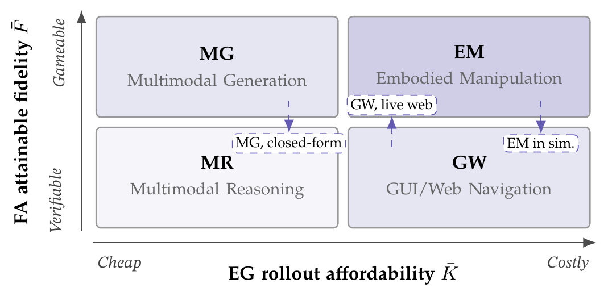

<h1 align="center">
  Self-Evolving Multimodal Agents
</h1>

<p align="center">
  <strong>
    A curated list of methods, mechanisms, and benchmarks for self-evolving multimodal agents
  </strong>
  <br>
  <sub>
    📄 Papers · 🧭 Taxonomy · 📊 Self-evolution benchmarks · 💻 Code ·
    🖥️ Companion project page
  </sub>
  <br>
  <sub>
    Contributions are welcome — open a PR to add a method, a benchmark, or a missing code link.
  </sub>
</p>

<p align="center">
  <a href="https://arxiv.org/abs/2611.14256">
    
  </a>
  <a href="https://jingjing12110.github.io/SE-MMAgents/">
    
  </a>
  <a href="#-key-literature">
    
  </a>
  <a href="LICENSE">
    
  </a>
</p>

<p align="center">
  This repository accompanies
  <a href="https://arxiv.org/abs/2611.14256">
    <em>A Cross-Scenario Survey and Analysis of Self-Evolving Multimodal Agents.</em>
  </a>
</p>

---

## 🧾 Contents
- [Definition & Scope](#-definition--scope)
- [The Three-Stage Self-Evolving Loop](#-the-three-stage-self-evolving-loop)
- [Key Literature](#-key-literature)
  - [Multimodal Reasoning](#multimodal-reasoning)
  - [Multimodal Generation](#multimodal-generation)
  - [GUI and Web Navigation](#gui-and-web-navigation)
  - [Embodied Manipulation](#embodied-manipulation)
  - [Self-Evolution Benchmarks](#self-evolution-benchmarks)
- [Citation](#-citation)

---

## 🧩 Definition & Scope

This repository collects multimodal agents whose improvement loop writes back into the agent itself. An entry is listed as a *method* when its loop satisfies four criteria and a differentia:

- **Autonomy**: no human input reaches the goals, the feedback, the updates, or the actions while the loop runs.
- **Freshness**: experience comes from the agent's current policy, not from a fixed dataset or a frozen teacher.
- **Durability**: the update lands in a persistent component (parameters, long-term memory, tools or skills, instructions) and changes the induced policy.
- **Recurrence**: the agent iterates for more than one cycle, each output being the next cycle's agent.
- **Self-reference**: the agent itself enters at least one meta-operator, namely goal sampling, feedback, or update, instead of only being the object of it.

Loops that satisfy the four criteria but not self-reference are *fixed loops*; they appear as controls rather than as entries. A *benchmark* entry is listed when it lets an agent write to persistent components across rounds or tasks and reports how its score changes.

An entry is not listed when its improvement is one-shot, when a human annotates each round, or when the update never reaches a persistent component.


---

## ♻️ The Three-Stage Self-Evolving Loop

We decompose each cycle of an autonomous learning loop into three stages, each governed by two factors. Only two of the six factors are bounded by scenario-level ceilings, the rollout count $\bar K$ and the feedback fidelity $\bar F$. The remaining four vary within a scenario. Self-evolving and fixed loops share the decomposition, and the scenarios differ by where the bottleneck binds.

<p align="center">
  
  <br>
  <em>The three stages, the two governing factors of each, and the ceilings on rollout count and feedback fidelity.</em>
</p>

```
cycle of an autonomous learning loop
├── 1. Experience Generation (EG)
│   ├── K_k   rollouts per goal, bounded by the rollout ceiling K̄
│   └── E[I]  goal-level outcome variance, a proxy for learnable information gain
├── 2. Feedback Acquisition (FA)
│   ├── F_ν   fidelity of the evaluator, bounded by the fidelity ceiling F̄
│   └── L_ν   share of decision points that receive credit
└── 3. Update Consolidation (UC)
    ├── S_ζ   retention of the cycle-k gain over later cycles
    └── G_ζ   generalization to goals outside the cycle-k goals
```

The two ceilings place the four scenarios on a positioning matrix. Multimodal reasoning faces neither low ceiling, multimodal generation a low $\bar F$ on open-ended prompts, GUI and Web navigation a low $\bar K$ under latency-bound episodes, and embodied manipulation both in physical deployment. Most embodied loops learn in simulation, where success predicates and cheap group sampling raise both ceilings toward the navigation cell, and verifiable sub-families of generation likewise raise $\bar F$. The placements are inferred from reported operating points.

<p align="center">
  
  <br>
  <em>The four scenarios placed by the rollout ceiling $\bar K$ and the fidelity ceiling $\bar F$.</em>
</p>


<!-- <details open>
<summary><b>Four scenarios and their design variable</b></summary>

| Scenario | Positioning | Design variable of the reviewed methods |
|--------|--------|--------|
| Multimodal Reasoning | High rollout and fidelity ceilings | Question and visual-input source |
| Multimodal Generation | Low fidelity ceiling | Verifier dependence on the policy |
| GUI and Web Navigation | Low rollout ceiling | Allocation and reuse of scarce rollouts |
| Embodied Manipulation | Both ceilings low on hardware | Feedback source |

</details> -->

---

## 📚 Key Literature

Each table is grouped by the design variable of its scenario. The title links the paper and the **Code** column links the official implementation where one exists, showing a dash otherwise. The **Provenance** column gives, for the goal sampler, the feedback function, and the evolution operator in that order, who realizes each meta-operator: 🟥 the agent itself, 🟦 an artifact fixed before the loop, 🟩 the environment or the task generation. A slash marks a meta-operator that two parties realize at once, so `🟦 🟦/🟥 🟦` reads a bootstrap sampler, an evaluator both environmental and agent-dependent, and a bootstrap update.

<!-- BEGIN GENERATED -->

### Multimodal Reasoning

<sub>High rollout and fidelity ceilings. Rows are grouped by question and visual-input source.</sub>

<details open>
<summary><b>Questions from datasets or fixed generators</b> (23)</summary>

| 📅 Year | 📝 Title | 🔀 Provenance | 💻 Code |
|------:|--------|--------|--------|
| 2025 | [ISR-DPO: Aligning Large Multimodal Models for Videos by Iterative Self-Retrospective DPO](https://arxiv.org/abs/2406.11280) | 🟦 🟥 🟦 | [code](https://github.com/snumprlab/ISR-DPO) |
| 2025 | [First SFT, Second RL, Third UPT: Continual Improving Multi-Modal LLM Reasoning via Unsupervised Post-Training](https://arxiv.org/abs/2505.22453) | 🟦 🟥 🟦 | [code](https://github.com/waltonfuture/MM-UPT) |
| 2025 | [Sherlock: Self-Correcting Reasoning in Vision-Language Models](https://arxiv.org/abs/2505.22651) | 🟦 🟥 🟦 | [code](https://github.com/DripNowhy/Sherlock) |
| 2025 | [SyncLoop: A Multimodal Dual-Loop Framework for Self-Improving Mathematical Reasoning](https://arxiv.org/abs/2507.16518) | 🟥 🟦 🟦 | [code](https://github.com/chen-xw/C2-Evo) |
| 2025 | [Self-Rewarding Vision-Language Model via Reasoning Decomposition](https://arxiv.org/abs/2508.19652) | 🟦 🟦/🟥 🟦 | [code](https://github.com/zli12321/Vision-SR1) |
| 2026 | [Agent0-VL: Exploring Self-Evolving Agent for Tool-Integrated Vision-Language Reasoning](https://arxiv.org/abs/2511.19900) | 🟦 🟥 🟦 | [code](https://github.com/aiming-lab/Agent0) |
| 2026 | [BUS: Brain-Inspired Unsupervised Self-Reflection via Backward Prediction for Multimodal Reasoning](https://arxiv.org/abs/2607.07361) | 🟦 🟥 🟦 | — |
| 2026 | [CoWorld Reasoner: Agentic Multimodal Reasoning with the Evolving Video World Model-Driven Harness](https://arxiv.org/abs/2610.21910) | 🟦 🟦 🟥 | [code](https://github.com/ModalityDance/CoWorld-Reasoner) |
| 2026 | [Self-Evolving Code-with-Image Reasoning](https://arxiv.org/abs/2608.11292) | 🟦 🟩 🟥 | — |
| 2026 | [Dynamo: Dynamic Skill-Tool Evolution for Vision-Language Agents](https://arxiv.org/abs/2606.30185) | 🟦 🟦 🟥 | — |
| 2026 | [EvoSpatial: Experience-Driven Skill and Tool Evolution for Spatial Reasoning Agents](https://arxiv.org/abs/2610.16679) | 🟦 🟩/🟥 🟥 | — |
| 2026 | [Self-Evolving Vision-Language Models for Image Quality Assessment via Voting and Ranking](https://arxiv.org/abs/2509.25787) | 🟦 🟥 🟦 | [code](https://github.com/bytedance/EvoQuality) |
| 2026 | [M^2Note: Continual Evolution of Vision Language Models via Mistake Notebook Learning](https://arxiv.org/abs/2607.00685) | 🟦 🟦/🟥 🟥 | — |
| 2026 | [MetaForge: A Self-Evolving Multimodal Agent that Retrieves, Adapts, and Forges Tools On Demand](https://arxiv.org/abs/2606.01801) | 🟦 🟦 🟥 | — |
| 2026 | [Self-Evolving Neuro-Symbolic Skills for Tool-Augmented Spatial Reasoning](https://arxiv.org/abs/2608.07955) | 🟦 🟦 🟥 | — |
| 2026 | [PhysNote: Self-Knowledge Notes for Evolvable Physical Reasoning in Vision-Language Model](https://arxiv.org/abs/2604.24443) | 🟦 🟦 🟥 | — |
| 2026 | [When Models Judge Themselves: Unsupervised Self-Evolution for Multimodal Reasoning](https://arxiv.org/abs/2603.21289) | 🟦 🟥 🟦 | [code](https://github.com/OPPO-Mente-Lab/LLM-Self-Judge) |
| 2026 | [Spatial Memory Agent: Experience-Grounded Procedure Memory for Spatial Intelligence](https://arxiv.org/abs/2608.12743) | 🟦 🟩/🟦 🟥 | — |
| 2026 | [TTRSD: Test-Time Reinforcement Learning with Self-Distillation for Vision-Language Models](https://arxiv.org/abs/2609.33414) | 🟦 🟥 🟦 | — |
| 2026 | [TTRV: Test-Time Reinforcement Learning for Vision Language Models](https://arxiv.org/abs/2510.06783) | 🟦 🟥 🟦 | [code](https://github.com/Akshit21112002/TTRV) |
| 2026 | [Transductive Visual Programming: Evolving Tool Libraries from Experience for Spatial Reasoning](https://arxiv.org/abs/2512.20934) | 🟦 🟥 🟦 | [code](https://github.com/transductive-visualprogram/tvp) |
| 2026 | [Vision-Zero: Scalable VLM Self-Improvement via Strategic Gamified Self-Play](https://arxiv.org/abs/2509.25541) | 🟦 🟩/🟥 🟦 | [code](https://github.com/wangqinsi1/Vision-Zero) |
| 2026 | [VisualEvolve: A Skill Self-Evolution Framework for Visual Reasoning](https://arxiv.org/abs/2610.28386) | 🟦 🟦 🟥 | — |

</details>

<details open>
<summary><b>Agent-generated questions</b> (17)</summary>

| 📅 Year | 📝 Title | 🔀 Provenance | 💻 Code |
|------:|--------|--------|--------|
| 2025 | [EvoLMM: Self-Evolving Large Multimodal Models with Continuous Rewards](https://arxiv.org/abs/2511.16672) | 🟥 🟥 🟦 | [code](https://github.com/mbzuai-oryx/EvoLMM) |
| 2026 | [DUEL: Adversarial Self-Play for Multimodal Reasoning](https://arxiv.org/abs/2605.24794) | 🟥 🟩/🟥 🟦 | — |
| 2026 | [EVE: Verifiable Self-Evolution of MLLMs via Executable Visual Transformations](https://arxiv.org/abs/2604.18320) | 🟥 🟩/🟥 🟦 | [code](https://github.com/0001Henry/EVE) |
| 2026 | [EvoVid: Temporal-Centric Self-Evolution for Video Large Language Models](https://arxiv.org/abs/2605.21931) | 🟥 🟥 🟦 | — |
| 2026 | [iReasoner: Trajectory-Aware Intrinsic Reasoning Supervision for Self-Evolving Large Multimodal Models](https://arxiv.org/abs/2601.05877) | 🟥 🟥 🟦 | [code](https://github.com/meghanaasunil/iReasoner) |
| 2026 | [Self-Evolving Visual Agent via Margin Reward](https://arxiv.org/abs/2610.15084) | 🟥 🟥 🟦 | [code](https://github.com/YWenxi/marvo) |
| 2026 | [RISE: Reliable Improvement in Self-Evolving Vision-Language Models](https://arxiv.org/abs/2605.20914) | 🟥 🟥 🟦 | [code](https://github.com/AMAP-ML/RISE) |
| 2026 | [Self-Evolving Spatial Reasoning in Vision Language Models via Geometric Logic Consistency](https://arxiv.org/abs/2605.18162) | 🟥 🟦/🟩 🟦 | — |
| 2026 | [SpatialEvo: Self-Evolving Spatial Intelligence via Deterministic Geometric Environments](https://arxiv.org/abs/2604.14144) | 🟥 🟩/🟥 🟦 | [code](https://github.com/ZJU-REAL/SpatialEvo) |
| 2026 | [Self-Evolving Visual Questioner](https://arxiv.org/abs/2606.13929) | 🟥 🟥 🟦 | [code](https://github.com/tianyi-lab/SeeQ) |
| 2026 | [Trinity: Self-Evolving Vision-Language Models with a Self-Verifier](https://arxiv.org/abs/2610.04469) | 🟥 🟥 🟦 | — |
| 2026 | [V-Zero: Self-Improving Multimodal Reasoning with Zero Annotation](https://arxiv.org/abs/2601.10094) | 🟥 🟥 🟦 | [code](https://github.com/SatonoDia/V-Zero) |
| 2026 | [Video-Zero: Self-Evolution Video Understanding](https://arxiv.org/abs/2605.14733) | 🟥 🟥 🟦 | — |
| 2026 | [VideoEvoHarness: Self Evolving Agent Harness from Unlabeled Videos for Video Understanding](https://arxiv.org/abs/2610.15389) | 🟥 🟥 🟥 | [code](https://github.com/Wei-Xin-Xu/VideoEvoHarness) |
| 2026 | [Paying More Attention to Visual Tokens in Self-Evolving Large Multimodal Models](https://arxiv.org/abs/2606.27373) | 🟥 🟥 🟦 | [code](https://github.com/mbzuai-oryx/VISE) |
| 2026 | [VisPlay: Self-Evolving Vision-Language Models](https://arxiv.org/abs/2511.15661) | 🟥 🟥 🟦 | [code](https://github.com/bruno686/VisPlay) |
| 2026 | [Program-Verified Self-Evolution for Vision-Language Models](https://arxiv.org/abs/2609.33855) | 🟥 🟩/🟥 🟦 | [code](https://github.com/ahmedheakl/VQS) |

</details>

<details open>
<summary><b>Agent-synthesized or retrieved images and videos</b> (5)</summary>

| 📅 Year | 📝 Title | 🔀 Provenance | 💻 Code |
|------:|--------|--------|--------|
| 2026 | [Active Zero: Self-Evolving Vision-Language Models through Active Environment Exploration](https://arxiv.org/abs/2602.11241) | 🟥 🟥 🟦 | [code](https://github.com/jinghan1he/Active-Zero) |
| 2026 | [Self-Evolving Vision Language Models for Structured Visual Understanding](https://arxiv.org/abs/2603.09206) | 🟥 🟥 🟦 | [code](https://github.com/zli12321/MM-Zero) |
| 2026 | [PhysEvolve: Verifier-Grounded Self-Evolution for Physical Reasoning with Executable Worlds](https://arxiv.org/abs/2610.34921) | 🟥 🟩/🟥 🟦 | [code](https://github.com/yelonhu/PhysEvolve) |
| 2026 | [Tempo-Zero: Recursive Self-Play in Executable Worlds for Video Reasoning](https://arxiv.org/abs/2610.32433) | 🟥 🟩/🟥 🟦 | [code](https://github.com/Alchemist-Jo/tempo-zero-code) |
| 2026 | [VICO: Visual Environments Co-Evolving for Vision-Language Model Reasoning](https://arxiv.org/abs/2610.10782) | 🟥 🟩/🟦 🟦 | — |

</details>

### Multimodal Generation

<sub>Low fidelity ceiling. Rows are grouped by verifier dependence on the policy.</sub>

<details open>
<summary><b>Self-verifiers updated with the policy</b> (12)</summary>

| 📅 Year | 📝 Title | 🔀 Provenance | 💻 Code |
|------:|--------|--------|--------|
| 2025 | [Co-Reinforcement Learning for Unified Multimodal Understanding and Generation](https://arxiv.org/abs/2505.17534) | 🟦 🟥/🟦 🟦 | [code](https://github.com/mm-vl/ULM-R1) |
| 2025 | [IRIS: Intrinsic Reward Image Synthesis](https://arxiv.org/abs/2509.25562) | 🟦 🟥 🟦 | — |
| 2025 | [SILMM: Self-Improving Large Multimodal Models for Compositional Text-to-Image Generation](https://arxiv.org/abs/2412.05818) | 🟦 🟥 🟦 | [code](https://github.com/LgQu/SILMM) |
| 2025 | [SUDER: Self-Improving Unified Large Multimodal Models for Understanding and Generation with Dual Self-Rewards](https://arxiv.org/abs/2506.07963) | 🟦 🟥 🟦 | [code](https://github.com/hongjx175/SUDER) |
| 2025 | [UniRL: Self-Improving Unified Multimodal Models via Supervised and Reinforcement Learning](https://arxiv.org/abs/2505.23380) | 🟦 🟥 🟦 | [code](https://github.com/showlab/unirl) |
| 2026 | [Ask, Solve, Generate: Self-Evolving Unified Multimodal Understanding and Generation via Self-Consistency Rewards](https://arxiv.org/abs/2606.27376) | 🟥 🟥 🟦 | [code](https://github.com/mbzuai-oryx/Ask-Solve-Generate) |
| 2026 | [Learning to Generate via Understanding: Understanding-Driven Intrinsic Rewarding for Unified Multimodal Models](https://arxiv.org/abs/2603.06043) | 🟦 🟥 🟦 | [code](https://github.com/matrix0721/GvU) |
| 2026 | [Turning Internal Gap into Self-Improvement: Promoting the Generation-Understanding Unification in MLLMs](https://arxiv.org/abs/2507.16663) | 🟥 🟥 🟦 | — |
| 2026 | [JarvisEvo: Towards a Self-Evolving Photo Editing Agent with Synergistic Editor-Evaluator Optimization](https://arxiv.org/abs/2511.23002) | 🟦 🟥 🟦 | [code](https://github.com/LYL1015/JarvisEvo) |
| 2026 | [Read It Back: Pretrained MLLMs Are Zero-Shot Reward Models for Text-to-Image Generation](https://arxiv.org/abs/2607.11886) | 🟦 🟥 🟦 | [code](https://github.com/huangrh99/AlphaGRPO) |
| 2026 | [Safe Autoregressive Image Generation with Iterative Self-Improving Codebooks](https://arxiv.org/abs/2606.27147) | 🟦 🟥 🟦 | — |
| 2026 | [Improving Text-to-Image Generation with Intrinsic Self-Confidence Rewards](https://arxiv.org/abs/2603.00918) | 🟦 🟥 🟦 | [code](https://github.com/wookiekim/SOLACE) |

</details>

<details open>
<summary><b>Co-evolving or lagged verifiers</b> (5)</summary>

| 📅 Year | 📝 Title | 🔀 Provenance | 💻 Code |
|------:|--------|--------|--------|
| 2025 | [Self-Rewarding Large Vision-Language Models for Optimizing Prompts in Text-to-Image Generation](https://arxiv.org/abs/2505.16763) | 🟦 🟥 🟦 | — |
| 2026 | [Dual-IPO: Dual-Iterative Preference Optimization for Text-to-Video Generation](https://arxiv.org/abs/2502.02088) | 🟦 🟥 🟦 | [code](https://github.com/SAIS-FUXI/IPO) |
| 2026 | [The Image as Its Own Reward: Reinforcement Learning with Adversarial Reward for Image Generation](https://arxiv.org/abs/2511.20256) | 🟦 🟥 🟦 | [code](https://github.com/showlab/Adv-GRPO) |
| 2026 | [ImageRSI: Verification-Driven Recursive Self-Improvement for Agentic Image Generation](https://arxiv.org/abs/2610.32120) | 🟦 🟥 🟥 | — |
| 2026 | [UniEvo-VL: An On-policy Self-Distillation Training Recipe for Multimodal Model Self-improvement](https://arxiv.org/abs/2609.38721) | 🟦 🟥/🟦 🟦 | — |

</details>

<details open>
<summary><b>Frozen self-verifiers</b> (11)</summary>

| 📅 Year | 📝 Title | 🔀 Provenance | 💻 Code |
|------:|--------|--------|--------|
| 2024 | [SceneCraft: An LLM Agent for Synthesizing 3D Scenes as Blender Code](https://arxiv.org/abs/2403.01248) | 🟦 🟥 🟥 | — |
| 2026 | [COMFYCLAW: Self-Evolving Skill Harnesses for Image Generation Workflows](https://arxiv.org/abs/2607.01709) | 🟦 🟥 🟥 | [code](https://github.com/Moms-Organic-Agent-Lab/comfyclaw) |
| 2026 | [Automatic Method Illustration Generation for AI Scientific Papers via Drawing Middleware Creation, Evolution, and Orchestration](https://arxiv.org/abs/2603.29590) | 🟦 🟥/🟦 🟥 | — |
| 2026 | [EvoDesign: Agentic Editable Diagram Creation via Design Expertise Evolution](https://arxiv.org/abs/2604.09568) | 🟦 🟥 🟥 | [code](https://github.com/GeminiLight/EvoDesign) |
| 2026 | [ManimAgent: Self-Evolving Multimodal Agents for Visual Education](https://arxiv.org/abs/2606.30296) | 🟦 🟩/🟥 🟥 | [code](https://github.com/jwj1342/Paper2Manim) |
| 2026 | [MemoGen: Can Past Experience Improve Future Text-to-Image Generation?](https://arxiv.org/abs/2606.03243) | 🟦 🟥/🟦 🟥 | [code](https://github.com/Chatonz/MemoGen) |
| 2026 | [On-Policy Self-Distillation for Multi-Turn Image Editing](https://arxiv.org/abs/2609.35611) | 🟦 🟥 🟦 | [code](https://github.com/liangbingzhao/MT-OPSD) |
| 2026 | [Agentic Physics-Grounded Video Generation via Memory-Augmented In-Context Reasoning](https://arxiv.org/abs/2610.23677) | 🟦 🟩/🟥 🟥 | [code](https://github.com/xxkkxxx/PhysRepair) |
| 2026 | [PRISM: Prompt Refinement via Image-Grounded Self-Rewarding Mechanism for Text-to-Image Generation](https://arxiv.org/abs/2607.24353) | 🟦 🟥 🟦 | [code](https://anonymous.4open.science/r/PRISM-FF81) |
| 2026 | [SIDiffAgent: Self-Improving Diffusion Agent](https://arxiv.org/abs/2602.02051) | 🟦 🟥 🟥 | [code](https://github.com/ayushsi42/sidiff_agent) |
| 2026 | [SymbOmni: Evolving Agentic Omni Models via Symbolic Concept Learning](https://arxiv.org/abs/2607.12042) | 🟦 🟩/🟥 🟥 | [code](https://github.com/Sphere-AI-Lab/symbomni) |

</details>

<details open>
<summary><b>External or programmatic verifiers</b> (5)</summary>

| 📅 Year | 📝 Title | 🔀 Provenance | 💻 Code |
|------:|--------|--------|--------|
| 2026 | [GenEvolve: Self-Evolving Image Generation Agents via Tool-Orchestrated Visual Experience Distillation](https://arxiv.org/abs/2605.21605) | 🟦 🟦 🟥 | [code](https://github.com/MeiGen-AI/GenEvolve) |
| 2026 | [Mutually Adversarial Self-Training with Evolving Data for Unified Multimodal Models](https://arxiv.org/abs/2609.36224) | 🟥 🟦 🟦 | — |
| 2026 | [OctoT2I: A Self-Evolving Agentic Text-to-Image Router](https://arxiv.org/abs/2606.01803) | 🟥 🟦 🟥 | [code](https://github.com/JaxJiang2642081986/OctoT2I) |
| 2026 | [Recursive Self-Improvement in Unified Multimodal Models](https://arxiv.org/abs/2610.03002) | 🟥 🟩 🟦 | — |
| 2026 | [RSIgen: Reciprocal Self-Improvement for Agentic Visual Generation](https://arxiv.org/abs/2610.18688) | 🟥 🟦 🟦 | — |

</details>

### GUI and Web Navigation

<sub>Low rollout ceiling. Rows are grouped by allocation and reuse of scarce rollouts.</sub>

<details open>
<summary><b>Stationary sampling of fixed goals</b> (10)</summary>

| 📅 Year | 📝 Title | 🔀 Provenance | 💻 Code |
|------:|--------|--------|--------|
| 2024 | [DigiRL: Training In-the-Wild Device-Control Agents with Autonomous Reinforcement Learning](https://arxiv.org/abs/2406.11896) | 🟦 🟥/🟦 🟦 | [code](https://github.com/DigiRL-agent/digirl) |
| 2025 | [Agent S: An Open Agentic Framework that Uses Computers Like a Human](https://arxiv.org/abs/2410.08164) | 🟦 🟥 🟥 | [code](https://github.com/simular-ai/Agent-S) |
| 2025 | [AppAgentX: Evolving GUI Agents as Proficient Smartphone Users](https://arxiv.org/abs/2503.02268) | 🟦 🟦 🟥 | [code](https://github.com/Westlake-AGI-Lab/AppAgentX) |
| 2025 | [Mobile-Agent-E: Self-Evolving Mobile Assistant for Complex Tasks](https://arxiv.org/abs/2501.11733) | 🟦 🟥 🟥 | [code](https://github.com/X-PLUG/MobileAgent/tree/main/Mobile-Agent-E) |
| 2025 | [MobileSteward: Integrating Multiple App-Oriented Agents with Self-Evolution to Automate Cross-App Instructions](https://arxiv.org/abs/2502.16796) | 🟦 🟥 🟥 | — |
| 2026 | [Agent S4: Evolutionary Computer Use](https://openreview.net/forum?id=P1rGwEYDxm) | 🟦 🟦 🟥 | [code](https://github.com/simular-ai/Agent-S/tree/main/agent_s4) |
| 2026 | [Reflect, Revise, Reuse: Training-Free Skill Evolution for GUI Agents](https://arxiv.org/abs/2609.17653) | 🟦 🟥/🟦 🟥 | [code](https://github.com/ZJU-REAL/EvoSkill-GUI) |
| 2026 | [MagicGUI-RMS: A Multi-Agent Reward Model System for Self-Evolving GUI Agents via Automated Feedback Reflux](https://arxiv.org/abs/2601.13060) | 🟦 🟥/🟦 🟦 | — |
| 2026 | [MAGNET: Towards Adaptive GUI Agents with Memory-Driven Knowledge Evolution](https://arxiv.org/abs/2601.19199) | 🟦 🟦 🟥 | [code](https://github.com/sunlibo2390/MAGNET) |
| 2026 | [WebCoach: Self-Evolving Web Agents with Cross-Session Memory Guidance](https://arxiv.org/abs/2511.12997) | 🟦 🟥 🟦 | [code](https://github.com/genglinliu/WebCoach) |

</details>

<details open>
<summary><b>Adaptive sampling of fixed goals</b> (3)</summary>

| 📅 Year | 📝 Title | 🔀 Provenance | 💻 Code |
|------:|--------|--------|--------|
| 2025 | [Efficient Multi-Turn RL for GUI Agents via Decoupled Training and Adaptive Data Curation](https://arxiv.org/abs/2509.23866) | 🟥 🟦 🟦 | [code](https://github.com/computer-use-agents/dart-gui) |
| 2025 | [UI-Genie: A Self-Improving Approach for Iteratively Boosting MLLM-Based Mobile GUI Agents](https://arxiv.org/abs/2505.21496) | 🟥/🟦 🟥 🟦 | [code](https://github.com/Euphoria16/UI-Genie) |
| 2026 | [MobileRL: Online Agentic Reinforcement Learning for Mobile GUI Agents](https://arxiv.org/abs/2509.18119) | 🟥 🟦 🟦 | [code](https://github.com/THUDM/MobileRL) |

</details>

<details open>
<summary><b>Adaptive generation of new goals</b> (4)</summary>

| 📅 Year | 📝 Title | 🔀 Provenance | 💻 Code |
|------:|--------|--------|--------|
| 2025 | [SkillWeaver: Web Agents can Self-Improve by Discovering and Honing Skills](https://arxiv.org/abs/2504.07079) | 🟥 🟥 🟥 | [code](https://github.com/OSU-NLP-Group/SkillWeaver) |
| 2026 | [Autonomous Continual Learning for Environment Adaptation of Computer-Use Agents](https://arxiv.org/abs/2602.10356) | 🟥 🟦 🟦 | [code](https://github.com/OSU-NLP-Group/ACuRL) |
| 2026 | [Learning to Adapt: Self-Improving Web Agent via Cognitive-Aware Exploration](https://arxiv.org/abs/2605.31365) | 🟥 🟥 🟦 | — |
| 2026 | [SEAgent: Self-Evolving Computer Use Agent with Autonomous Learning from Experience](https://arxiv.org/abs/2508.04700) | 🟥 🟦 🟦 | [code](https://github.com/SunzeY/SEAgent) |

</details>

### Embodied Manipulation

<sub>Both ceilings low on hardware. Rows are grouped by feedback source.</sub>

<details open>
<summary><b>Environment feedback</b> (11)</summary>

| 📅 Year | 📝 Title | 🔀 Provenance | 💻 Code |
|------:|--------|--------|--------|
| 2026 | [ASPIRE: Agentic Skills Discovery for Robotics](https://arxiv.org/abs/2607.00272) | 🟦 🟩 🟥 | [code](https://github.com/NVlabs/ASPIRE) |
| 2026 | [Don't Drop the BATON: Long-Horizon Robot Manipulation via Agentic Subtask Exploration and Transition-Aware Memory](https://arxiv.org/abs/2608.16889) | 🟦 🟩 🟥 | — |
| 2026 | [EmbodiedEvo: Self-Evolving Coding Agent for Physical Intelligence](https://arxiv.org/abs/2610.18867) | 🟦 🟩 🟥 | [code](https://github.com/Einsia/EmbodiedEvo) |
| 2026 | [EmbodiedRSI: Active Continual Robot Learning through Hypothesis-Guided Co-Evolution](https://arxiv.org/abs/2610.10498) | 🟥 🟩 🟥 | — |
| 2026 | [Harness VLA: Steering Frozen VLAs into Reliable Manipulation Primitives via Memory-Guided Agents](https://arxiv.org/abs/2607.08448) | 🟦 🟩 🟥 | [code](https://github.com/RLinf/RPent) |
| 2026 | [Trust-Calibrated VLA Policy Post-Training with Evolving Imagination](https://arxiv.org/abs/2610.16517) | 🟦 🟩/🟥 🟦 | [code](https://github.com/li-wenzhan/MERL) |
| 2026 | [Policy-Level Recursive Self-Improvement for Embodied AI with a Criticality World Model](https://arxiv.org/abs/2607.28251) | 🟥 🟩 🟦 | — |
| 2026 | [RoboBridge: A Self-Evolving Embodied Agent Framework for Sim-to-Real Transfer](https://arxiv.org/abs/2610.02717) | 🟦 🟩/🟦 🟥 | — |
| 2026 | [RoboHarn-Evo: Evolving Hierarchical Physical Knowledge for Self-Improving Robotic Manipulation](https://arxiv.org/abs/2609.37583) | 🟦 🟩 🟥 | [code](https://github.com/RUCKBReasoning/RoboHarn-Evo) |
| 2026 | [Scale and Selection: What Makes Automatic Harness Evolution Work for Visual-Interface Robot Agents](https://arxiv.org/abs/2609.39304) | 🟦 🟩 🟥 | — |
| 2026 | [ViSkill: Reinforcing VLM Agents with Evolving Visual-Native Skills](https://arxiv.org/abs/2610.12403) | 🟦 🟥/🟩 🟥 | [code](https://github.com/ZJU-REAL/ViSkill) |

</details>

<details open>
<summary><b>Agent-generated feedback</b> (10)</summary>

| 📅 Year | 📝 Title | 🔀 Provenance | 💻 Code |
|------:|--------|--------|--------|
| 2025 | [A Pragmatist Robot: Learning to Plan Tasks by Experiencing the Real World](https://arxiv.org/abs/2507.16713) | 🟦 🟥 🟥 | [code](https://github.com/leggedrobotics/pragmabot) |
| 2025 | [Self-Improving Embodied Foundation Models](https://arxiv.org/abs/2509.15155) | 🟦 🟥 🟦 | [code](https://github.com/self-improving-efms/self-improving-efms.github.io) |
| 2026 | [Evolvable Embodied Agent for Robotic Manipulation via Long Short-Term Reflection and Optimization](https://arxiv.org/abs/2604.13533) | 🟦 🟥/🟩 🟥 | — |
| 2026 | [Motus2: A Self-Evolving General World Model for Dexterous Manipulation](https://arxiv.org/abs/2608.30237) | 🟦 🟥 🟦 | [code](https://github.com/shengshu-ai/Motus2) |
| 2026 | [Playful Agentic Robot Learning](https://arxiv.org/abs/2606.19419) | 🟥 🟥/🟩 🟥 | [code](https://github.com/Playful-RATs/rats) |
| 2026 | [RoboEvolve: Co-Evolving Planner-Simulator for Robotic Manipulation with Limited Data](https://arxiv.org/abs/2605.13775) | 🟥 🟥 🟦 | — |
| 2026 | [RoboRSI: Stable, Efficient, and Reusable Robot Self-Evolution in Complex Real-World Environments](https://arxiv.org/abs/2610.12424) | 🟥 🟥/🟩 🟥 | [code](https://github.com/nssmd/RoboRSI) |
| 2026 | [Self-Correcting VLA: Online Action Refinement via Sparse World Imagination](https://arxiv.org/abs/2602.21633) | 🟦 🟥 🟦 | [code](https://github.com/Kisaragi0/SC-VLA) |
| 2026 | [SEAR: Self-Evolving Agentic Robotics](https://arxiv.org/abs/2610.18792) | 🟥 🟥/🟦 🟥 | [code](https://github.com/Self-Evolving-Agentic-Robotics/SEAR) |
| 2026 | [Self-Evolving Embodied Agents via Skill-Harness Evolution](https://arxiv.org/abs/2608.11350) | 🟦 🟥/🟩 🟥 | — |

</details>

<details open>
<summary><b>External-model feedback</b> (5)</summary>

| 📅 Year | 📝 Title | 🔀 Provenance | 💻 Code |
|------:|--------|--------|--------|
| 2025 | [Reflection-Based Task Adaptation for Self-Improving VLA](https://arxiv.org/abs/2510.12710) | 🟥 🟦/🟩 🟦 | — |
| 2026 | [Agentic-VLA: Efficient Online Adaptation for Vision-Language-Action Models](https://arxiv.org/abs/2605.22896) | 🟦 🟦/🟥 🟦 | — |
| 2026 | [EvoVLA: Self-Evolving Vision-Language-Action Model](https://arxiv.org/abs/2511.16166) | 🟦 🟦/🟥 🟦 | [code](https://github.com/AIGeeksGroup/EvoVLA) |
| 2026 | [Find Something You Can't Do: Agentic Real-World Reinforcement Learning for Self-Improving VLA Models](https://arxiv.org/abs/2609.32069) | 🟥 🟦 🟦 | [code](https://github.com/FangYzzz/FIND) |
| 2026 | [Co-Evolving Robot Orchestrators and Policies through Deployment](https://arxiv.org/abs/2610.09228) | 🟦 🟦 🟥 | — |

</details>

### Self-Evolution Benchmarks

<sub>Measuring self-evolving capability. Rows are grouped by scenario measured.</sub>

<details open>
<summary><b>GUI and web navigation</b> (2)</summary>

| 📅 Year | 📝 Title | 🧪 Tasks | ✍️ Writes | 💻 Code |
|------:|--------|--------|--------|--------|
| 2026 | [MemGUI-Bench: Benchmarking Memory of Mobile GUI Agents in Dynamic Environments](https://arxiv.org/abs/2602.06075) | 128 tasks, 26 Android apps | any (M, T) | [code](https://github.com/lgy0404/MemGUI-Bench) |
| 2026 | [MMG2Skill: Can Agents Distill In-the-Wild Guides into Self-Evolving Skills?](https://arxiv.org/abs/2606.01993) | 130 tasks, desktop and games | T | [code](https://github.com/NJU-LINK/MMG2Skill) |

</details>

<details open>
<summary><b>Embodied manipulation</b> (3)</summary>

| 📅 Year | 📝 Title | 🧪 Tasks | ✍️ Writes | 💻 Code |
|------:|--------|--------|--------|--------|
| 2026 | [Where is Physical RSI Capability From? An Observational Scaling Law of LLM-as-Policy](https://arxiv.org/abs/2610.26848) | 18 tasks, RoboDojo | M, T | [code](https://github.com/PhysRSI-Eval/PhysRSI-Eval-code) |
| 2026 | [RobotAgentBench: Towards Open-World Robot Autonomy](https://arxiv.org/abs/2610.34649) | 116 tasks, Isaac Sim | T | [code](https://github.com/AetherLabsAI/RobotAgentBench) |
| 2026 | [SEAR: Self-Evolving Agentic Robotics](https://arxiv.org/abs/2610.18792) | 330 simulated, 5 hardware tasks | P, M, T | [code](https://github.com/Self-Evolving-Agentic-Robotics/SEAR) |

</details>

<details open>
<summary><b>Across reasoning, generation, and manipulation</b> (1)</summary>

| 📅 Year | 📝 Title | 🧪 Tasks | ✍️ Writes | 💻 Code |
|------:|--------|--------|--------|--------|
| 2026 | [Flex-RSI: Benchmarking Recursive Self-Improvement of Frontier Agents](https://arxiv.org/abs/2611.08946) | 24 tasks: robot simulation, video and spatial QA, image and video generation | I, T | [code](https://github.com/flex-rsi/rsi-bench) |

</details>

<details open>
<summary><b>Outside the four scenarios</b> (7)</summary>

| 📅 Year | 📝 Title | 🧪 Tasks | ✍️ Writes | 💻 Code |
|------:|--------|--------|--------|--------|
| 2026 | [EmbodiedCLBench: Evaluating Continual Learning for Self-Evolving Embodied Agents](https://arxiv.org/abs/2610.13021) | 268 tasks, offline state graphs | M, T | [code](https://github.com/PKU-VaLuE-Lab/EmbodiedCLBench) |
| 2026 | [GameBoyWorlds: A Testbed for Self-Improvement in Embodied Video Games](https://arxiv.org/abs/2609.32093) | 500 tasks, 10 games | any (P, M, I) | [code](https://github.com/DhananjayAshok/GameBoyWorlds-Benchmark) |
| 2026 | [GameVerse: Can Vision-Language Models Learn from Video-Based Reflection?](https://arxiv.org/abs/2603.06656) | 15 games | I | [code](https://github.com/THUSI-Lab/GameVerse) |
| 2026 | [MC-EvoBench: Auditing Experience-Driven Self-Improvement in Minecraft Agents](https://arxiv.org/abs/2610.13829) | 80 tasks, Minecraft | M | [code](https://github.com/xzw-ustc/mc-bench-open-source) |
| 2026 | [OmniGameArena: A Unified UE5 Benchmark for VLM Game Agents with Improvement Dynamics](https://arxiv.org/abs/2606.09826) | 2 of 12 UE5 games | M, I | [code](https://github.com/mxlin043/OmniGameArena) |
| 2026 | [Mastering PokeGym: Graph-Guided Multimodal Evolution at Test Time](https://arxiv.org/abs/2604.08340) | 114 tasks, Pokémon Z-A | any (T, I) | — |
| 2026 | [SelfImprove-Bench: Evaluating Generalization in Self-Improving Agents](https://arxiv.org/abs/2611.02797) | 6 games | any (M, T, I) | [code](https://github.com/theseus-labs-rsi/SelfImprove-Bench) |

</details>

<!-- END GENERATED -->

---

## 📌 Citation

```bibtex
@article{jiang2026selfevolvingmmagents,
	title   = {A Cross-Scenario Survey and Analysis of Self-Evolving Multimodal Agents},
	author  = {Jiang, Jingjing},
	journal = {arXiv preprint arXiv:2611.14256},
	year    = {2026}
}
```
